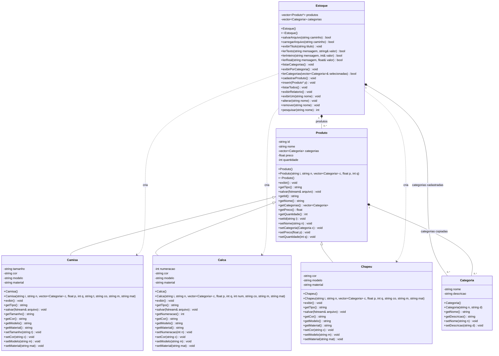

# Diagrama de classes

Diagrama UML baseado nas seis classes implementadas nos arquivos de cabeçalho do projeto.

## Leitura do diagrama

- `+` indica membro público; `-` indica atributo privado.
- A seta com triângulo indica herança pública: `Camisa`, `Calca` e `Chapeu` herdam de `Produto`.
- O losango preenchido indica composição. `Estoque` mantém os produtos e os destrói ao removê-los ou ao ser destruído. As categorias são armazenadas por valor nos vetores de `Estoque` e de `Produto`.
- `1` e `0..*` indicam um proprietário e zero ou mais elementos, respectivamente. Embora o cadastro interativo exija pelo menos uma categoria, a classe `Produto` permite um vetor vazio.
- As setas tracejadas indicam que `Estoque` cria instâncias das três subclasses.
- `vector~T~` representa `vector<T>` na sintaxe Mermaid.

`Produto` é uma classe concreta. Seu destrutor e os métodos `exibir()`, `getTipo()` e `salvar(fstream&)` são virtuais; as três subclasses sobrescrevem esses métodos. Os atributos e métodos herdados não são repetidos nas subclasses.

Cada produto guarda cópias das categorias, sem compartilhar as mesmas instâncias do catálogo do estoque. Os qualificadores `const` de `Categoria::getNome()` e `Categoria::getDescricao()` foram omitidos na representação dos métodos para facilitar a leitura.

`main.cpp` contém a função de entrada e o menu, mas não define uma classe, por isso não aparece no diagrama.
